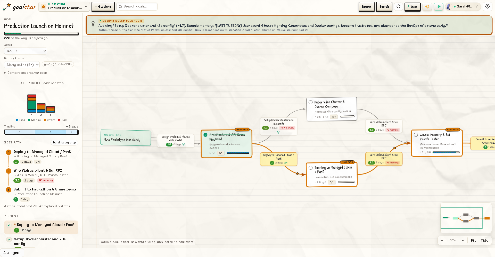
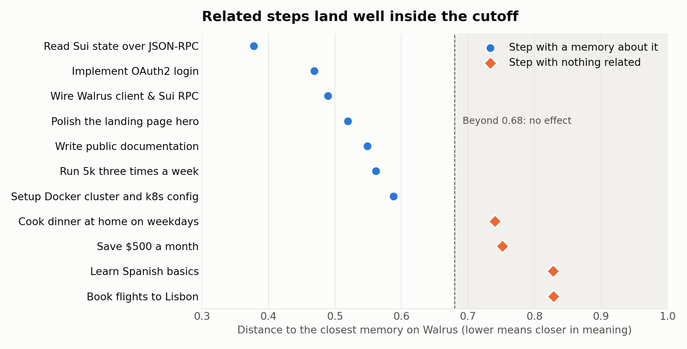
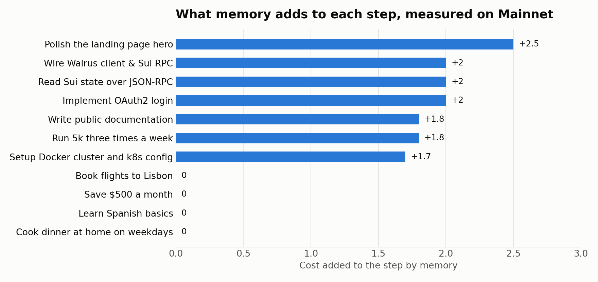
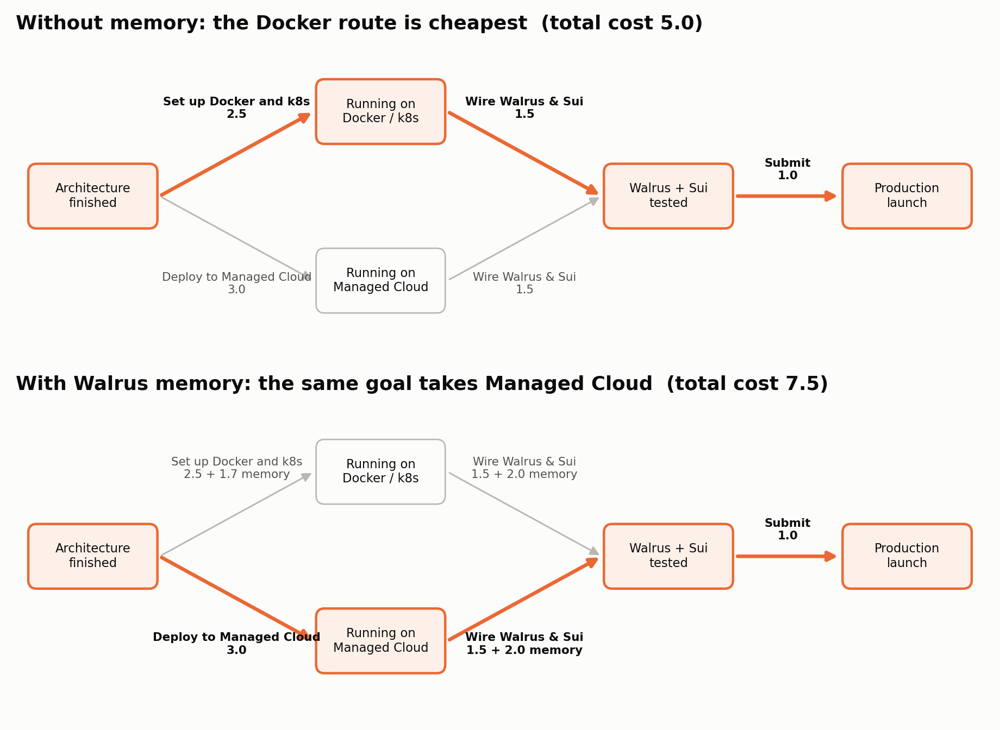
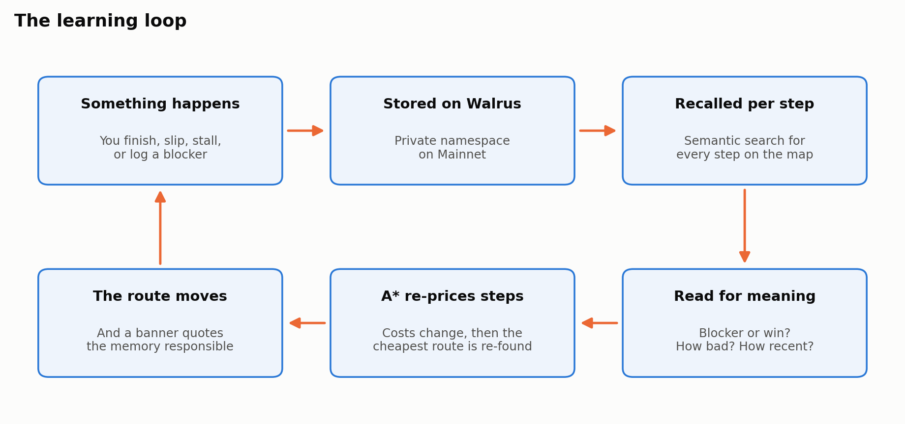
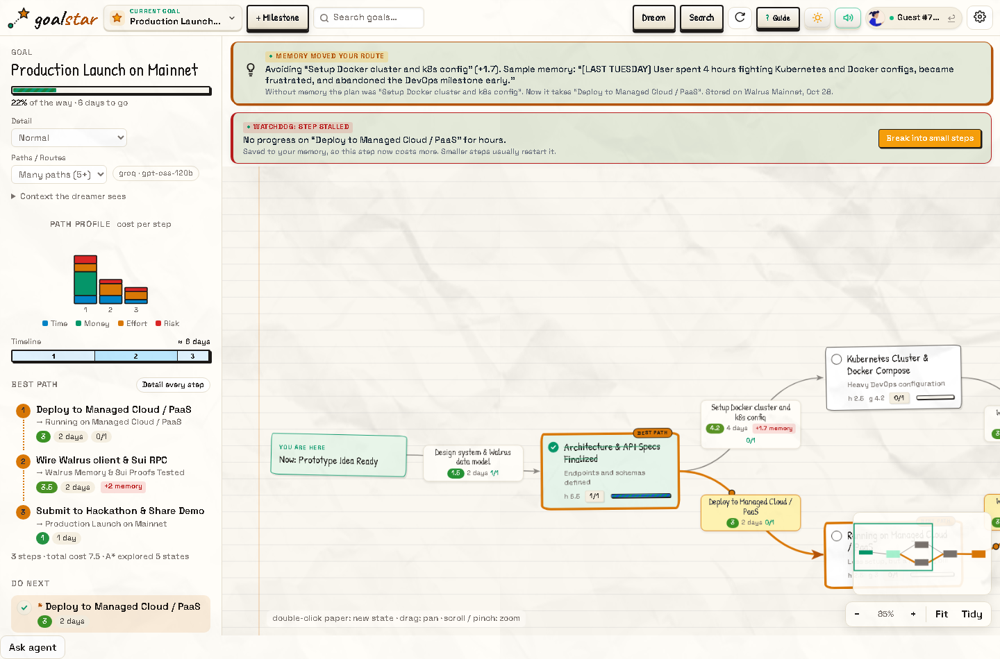
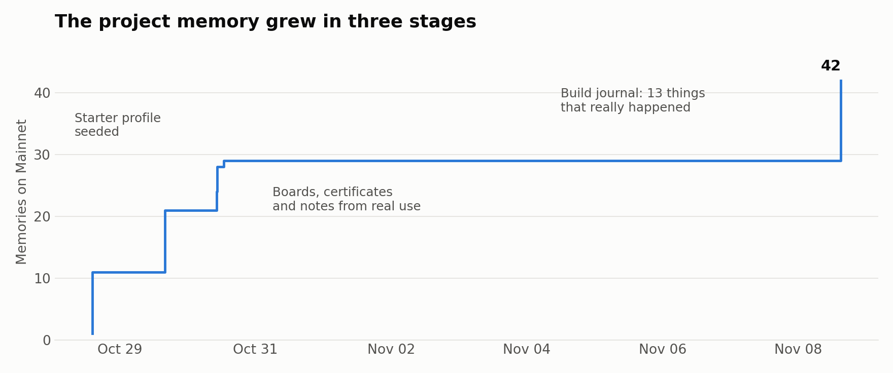
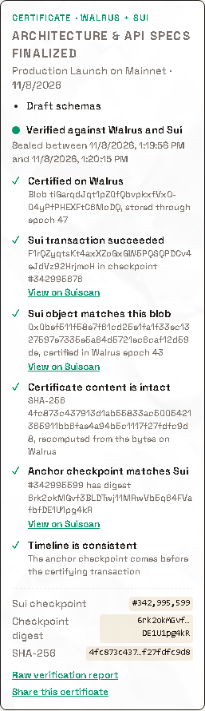

# GoalStar: A Planner That Remembers Where You Got Stuck

*Built for the Total Recall hackathon, Track 02: Smart Agents for Real Life. Uses Walrus Memory on Mainnet and Tatum's Sui gateway.*

Most plans die the same way. You write down the steps, something goes wrong on step three, and the plan never finds out. It keeps telling you to do the thing that just cost you a weekend. So you stop opening it.

GoalStar is a planner that finds out. It treats a goal as a map, finds the cheapest route across it, and remembers on Walrus what actually happened to you. When a memory makes a route more expensive, the route moves, and GoalStar tells you which memory did it.



## Why a goal is a pathfinding problem

"Get a job abroad" isn't a list. There are several ways to get there, and which one is best depends on you.

GoalStar draws it as a graph:

- **Milestones are places.** Each one is something that becomes true, like "Signed with a recruiter".
- **Actions are roads.** Each one is a step you take, rated 0 to 10 for time, money, effort and risk.
- **A road's cost** is those four ratings averaged using your own priorities, plus whatever memory adds.

Finding the best plan is then the same problem as finding the fastest way across a city. GoalStar solves it with A*, the search algorithm behind a lot of game and map routing.

### How A* decides

A* keeps a list of places it could look at next, and always opens the one with the lowest score:

$$f = g + h$$

- **g** is what it has cost to get here. That part is known.
- **h** is an estimate of what's left to the goal.

Those two numbers together are why A* is fast. Going only by g, it would spread out in every direction. Going only by h, it would rush at whatever looks close and miss better roads. Together they keep it heading toward the goal without ignoring what the journey has cost so far.

Here is a real run, for a designer who wants to work abroad. There are three routes: apply directly, hire a recruiter, or do a master's degree. Every number comes from GoalStar's planner:

| A* opens, in order | g (so far) | h (left) | f |
| --- | --- | --- | --- |
| Mid-level designer, employed locally | 0.00 | 6.00 | 6.00 |
| Signed with a recruiter | 3.00 | 2.00 | 5.00 |
| Working abroad on a sponsored visa | 6.50 | 0.00 | 6.50 |

It reaches the goal after opening just three of the five milestones. The recruiter route costs 6.50.

"Best" depends on what you care about, so the same map gives different answers:

| Your situation | Route A* picks |
| --- | --- |
| Balanced priorities | Hire a recruiter |
| Money is tight | Apply directly |
| You can't afford risk | Do the master's degree |
| You remember two recruiters ghosting you for three weeks | Apply directly |

The last row is the point of the project.

### Why A* and not a simple shortest-path search

On a map this small, Dijkstra's algorithm would find the route too. A* earns its place because GoalStar's maps aren't finished when the search starts. An AI drafts them, and they can be extended. When no route reaches the goal yet, **Search** uses f to pick the most promising milestone and asks the AI to expand that one. A* decides where the expensive AI calls go.

The AI also supplies h, so h can be wrong. If it estimates too high, A* can skip a road that was actually cheaper. We hit exactly that: on our sample board, a high estimate on one branch meant the search never looked at the other one, so no memory could have moved the route. The search reopens a milestone when a cheaper way in turns up, but that can't rescue a road it never looked at. So the sample board's estimates now match its real remaining costs.

## How memory changes a route

A step's final cost is:

$$\text{cost} = \text{weighted}(\text{time}, \text{money}, \text{effort}, \text{risk}) + \text{memory}$$

The memory part is worked out fresh for every step, in three moves.

**1. Walrus finds what's relevant.** Each step's name becomes its own semantic search on Walrus. "Setup Docker cluster and k8s config" finds a memory about "fighting Kubernetes and Docker configs" without any keyword list. Search returns a distance, and the real numbers separate cleanly: steps with a related memory came in between 0.38 and 0.59, and unrelated goals at 0.74 or more.



**2. GoalStar reads what the memory says.** Being related isn't enough, since a memory could be good news. A blocker raises the cost, and lost hours or burnout raise it further. A win lowers it. "No blockers today" and standing rules like "when a task stalls, split it" don't count as complaints. If one memory blames one thing and praises another, the part naming the step decides.

**3. Recent memories count for more.** Older ones fade, and a newer win on the same thing cancels an old blocker. The route can change back as you improve.

Put together:

$$\text{added cost} = 4 \times \text{severity} \times \text{relevance} \times \text{recency}$$

For the Docker memory, that's 4 × 0.92 × 0.51 × 0.89 = **+1.7**.



Here's what that does on the sample goal. Self-hosting with Docker is cheapest on paper, at 5.0. With memory, Docker costs more, and the plan moves to Managed Cloud. The "Wire Walrus & Sui" step picks up +2.0 on both routes, so it can't be the reason the route moved, and GoalStar doesn't blame it.



GoalStar gets this comparison by planning twice, with and without memory. So the banner reports what memory actually changed.

## It learns without being told

A memory system that depends on you typing notes stops learning when you get busy, so GoalStar writes down what it can see.



- **You finish a step.** It records how long the step really took against the plan. A big slip is stored as a delay.
- **You go quiet.** If the next step on your route sees no progress for 48 hours, the watchdog writes the stall to memory, which makes that step cost more, and offers to break it into smaller pieces.
- **You log something.** Type it in the app, or from a terminal without leaving your editor:

  ```bash
  npm run cli "Spent 3 hours debugging Docker configs, exhausted."
  ```

  About 30 seconds later, once Walrus has indexed it, the open app re-prices the route with no reload. We measured 29 and 33 seconds.
- **You plan something new.** The AI drafting a new map gets your relevant memories and is told to avoid what blocked you, so a fresh goal doesn't repeat an old mistake.



## Memory that belongs to you

Each person gets a private namespace on Walrus, derived on the server from a secret memory ID. Your goals only use your memories. Copy the ID into the CLI or another device, and the same memory follows you there.

The sample goal is the one exception. It also borrows the project's memories, labelled "Sample memory", so a first-time visitor can see a route move before logging anything.

## How GoalStar itself learned

The project's own namespace holds 42 memories on Mainnet, by the relayer's count. They arrived in three stages:



1. **Starter profile (October 28–29).** Seeded patterns that gave the planner something to work with, including the Docker memory above. These are examples, not events.
2. **Real use (October 30).** Notes, boards and certificates from using the app.
3. **Build journal (November 8).** Thirteen things that really happened while building this.

The journal includes the failure that taught us the most. Our first learning loop was three hardcoded keyword rules. It looked alive, with a banner, a memory count and penalties in the code. When we measured it, it added zero for almost every real memory. The product appeared to learn and didn't. Replacing it with semantic search, and then reading what each memory says, is what made memory actually steer the route. That failure is in the journal too.

So is Tatum's JSON-RPC endpoint returning 404 on every call, which led to the next section.

## Proof with Tatum

Sui has deprecated JSON-RPC, so GoalStar reads the chain through **Tatum's native gRPC gateway** (`sui-mainnet-grpc.gateway.tatum.io`). There is no fallback node and no placeholder data. If Tatum can't answer, sealing fails with an error.

Finishing a milestone can produce a certificate you can share:

1. **Anchor.** GoalStar reads the latest checkpoint through Tatum and embeds its digest, with a SHA-256 of the contents.
2. **Store.** The certificate goes to Walrus through Tatum's Storage API, and Walrus certifies it in a real Sui transaction, usually within a minute.
3. **Verify.** Anyone with the link can re-check it, with no sign-in. GoalStar re-reads Tatum and Walrus instead of trusting its own records:



The certificate can't be backdated, because that checkpoint's digest didn't exist before that moment. It can't be post-dated either, because the certifying transaction is onchain. To be clear about what this proves: a record existed in that window, unaltered. It doesn't prove the work was good. It's a progress record you can show a mentor or funder.

Tatum's free tier allows 3 requests per second, so every call shares one rate limiter and page views share a short-lived cached read of the chain head.

## What it can't do yet

- **Close calls blur.** Searching by meaning can't always separate two closely related tools. Steps for Sui JSON-RPC and Sui gRPC both pick up +2 from our memories, even though only one of them caused the trouble.
- **Sign-in isn't verified.** Your memory ID is what protects your memory, so treat it like a password. To reach your memory on a new device, you paste the ID.
- **Reading memories is rule-based.** It's transparent and needs no extra AI call, but unusual phrasing can be misread.

## Try it

- **Live app:** REPLACE_WITH_DEMO_URL
- **Code:** REPLACE_WITH_REPO_URL

Run it locally, then take the guided tour. It runs each feature for real and reports what passed:

```bash
npm install
npm start
npm run try
```

- **Walrus account:** `0x49cb5c5550e8f69445a4af7ec37f2088b54ed8ce10667dc0fa03c2f503ca2cb5`
- **Relayer:** `https://relayer.memory.walrus.xyz`
- **Project namespace:** `goalstar-workflows`

A plan shouldn't punish you for finding out how things really go. GoalStar remembers, and plans around it.
